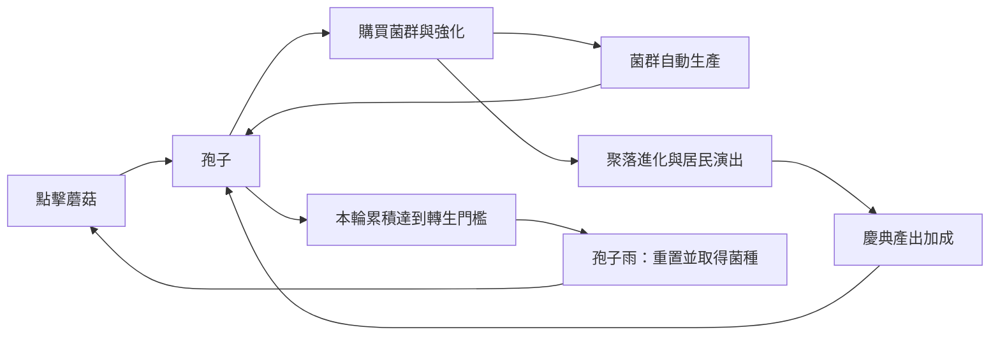

# 孢子森林：現況遊戲規格書

日期：2026-10-11。程式基準：`672f986` 加上同日菇菇圖鑑更新，來源為 [index.html](../index.html)。本文件描述已實作行為；[擴充提案](EXPANSION_PLAN.md)標示後續功能。核對方式為原始碼查核與聚焦瀏覽器檢查；沒有進行完整長時間平衡試玩。

## 1. 定位與玩家循環

繁體中文、單人、可在手機與電腦瀏覽器遊玩的蘑菇增量遊戲。玩家點擊主蘑菇獲得孢子，購買自動生產菌群與強化，讓野地進化成城堡；期間出現金色蘑菇與居民慶典。累積足夠收益後，以「孢子雨」重置本輪，換取永久菌種加成。

短期目標是買得起下一個菌群或強化；中期目標是達成聚落門檻；長期目標是累積菌種、提高產出。已有三位菇菇的收藏圖鑑，目前沒有故事結局、勝利畫面、居民好感或裝飾編輯。

## 2. 資源、產出與操作

### 資源定義

| 名稱／欄位 | 意義 |
|---|---|
| 孢子 `sp` | 可消費餘額，購買時扣除 |
| 本輪累積 `total` | 每次收益都增加，消費不扣除，轉生歸零 |
| 菌種 `seeds` | 轉生永久資源，每顆使菌種倍率增加 0.1 |
| 菌群數量 `g` | 7 個位置的數量陣列 |
| 強化 `bought` | 已購買強化 ID，單輪各買一次 |
| 紀錄 `best`／`peak` | 轉生時更新的歷輪累積最佳值／即時 DPS 最高值；`best` 目前沒有專屬 UI |

### 權威公式

以下名稱對應 `derive`、`cost`、`basePps`、`pps`、`comboMul`、`tapVal`、`seedGain`。

- 菌種倍率 = `1 + seeds × 0.1`，屬線性累加；10 顆為 ×2，不是 `1.1^10`。
- 菌群下一個價格 = `ceil(基礎價格 × 1.15^已持有數量)`。
- 基礎每秒產出 = `Σ(單位產出 × 數量 × 該菌群強化倍率) × 全體強化倍率 × 菌種倍率`。
- 當前每秒產出 = `基礎每秒產出 × 孢子狂潮倍率 × 慶典倍率`。
- 連擊倍率 = `1 + min(連擊數, 50) × 0.02`，最高 ×2。
- 普通點擊收益 = `(點擊強化倍率 × 菌種倍率 + 當前每秒產出 × 點擊產量比例) × 連擊倍率 × 狂熱點擊倍率`。
- 暴擊收益 = 普通點擊收益 ×10。基礎暴擊率 5%，購買敏銳菌褶後 10%。
- 轉生所得菌種 = `floor(sqrt(total / 1,000,000))`。

例：10 個未強化苔蘚、0 菌種，基礎每秒產出為 2；下一個苔蘚價格為 `ceil(15 × 1.15^10) = 61`。已有 10 菌種則每秒產出為 4；慶典加狂潮同時生效時為 `4 × 1.5 × 7 = 42`。

無強化、無菌種、第一下點擊時，連擊值為 0，普通收益為 1。連點間隔小於 450ms 時連擊加 1，否則點下時扣 3、最低為 0；距離最後點擊超過 900ms 後，每 100ms 扣 1。連擊達 5 才顯示文字。

整個 `.stage` 場景接收 `pointerdown`，包括主蘑菇外的場景空白；不是只有主蘑菇圖案可取得收益。自動收益每 100ms 加入 `pps()/10`，並非按實際經過時間補算；背景計時器可能受瀏覽器節流。

即時 DPS 為最近 3 秒點擊收益總和／3，加上當前自動每秒產出；手速為這 3 秒的點擊次數／3。顯示數字透過 `fmt` 縮寫、截位，計算仍使用原始數值。

## 3. 菌群與強化

### 菌群表

| 順序 | 菌群 | 基礎價格 | 基礎孢子／秒 | 場景顯示上限 |
|---|---|---:|---:|---:|
| 0 | 苔蘚地毯 | 15 | 0.2 | 30 |
| 1 | 小香菇 | 120 | 1.5 | 12 |
| 2 | 菌絲網路 | 1,300 | 10 | 12 |
| 3 | 螢光菇群 | 14,000 | 60 | 12 |
| 4 | 蘑菇精靈 | 200,000 | 400 | 8 |
| 5 | 古老菌王 | 3,300,000 | 2,500 | 4 |
| 6 | 星際孢囊 | 60,000,000 | 18,000 | 6 |

顯示上限只限制繪製數量，不限制購買或產出。苔蘚永遠可見；其他菌群在「前一種菌群數量大於 0」或「本輪累積達該菌群基礎價格的一半」時揭露。可見不代表買得起；不足餘額會停用購買按鈕。每次購買一個，目前沒有批量購買。

### 強化表

未註明條件者從一開始就會出現在強化清單，仍須有足夠孢子。已購買者從清單移除。

| ID | 名稱 | 價格 | 顯示條件 | 效果 |
|---|---|---:|---|---|
| t1 | 厚實菌傘 | 100 | 無 | 點擊強化倍率 ×2 |
| g0 | 晨露滋養 | 500 | 苔蘚 ≥10 | 苔蘚產出 ×2 |
| g1 | 椴木堆 | 3,000 | 小香菇 ≥10 | 小香菇產出 ×2 |
| t2 | 孢子噴發 | 8,000 | 無 | 點擊額外取得當前每秒產出的 1% |
| c1 | 敏銳菌褶 | 20,000 | 無 | 暴擊率 +5 個百分點 |
| g2 | 地下根脈 | 30,000 | 菌絲網路 ≥10 | 菌絲網路產出 ×2 |
| a1 | 潮濕季節 | 100,000 | 無 | 全體菌群產出 ×1.5 |
| k1 | 金色菌絲 | 250,000 | 無 | 金色蘑菇排程間隔 ×0.6 |
| g3 | 月光浴 | 400,000 | 螢光菇群 ≥10 | 螢光菇群產出 ×2 |
| t3 | 共生手套 | 1,000,000 | 無 | 點擊強化倍率 ×5 |
| g4 | 精靈契約 | 5,000,000 | 蘑菇精靈 ≥10 | 蘑菇精靈產出 ×2 |
| a2 | 森林意識 | 30,000,000 | 無 | 全體菌群產出 ×2 |
| g5 | 王冠傳承 | 80,000,000 | 古老菌王 ≥10 | 古老菌王產出 ×2 |
| g6 | 銀河黴菌 | 1,500,000,000 | 星際孢囊 ≥10 | 星際孢囊產出 ×2 |

點擊強化倍率作用於公式的固定點擊部分，產量比例部分另外相加。菌群清單顯示的單位產出包含菌群、全體和菌種強化，不包含當下慶典／狂潮；上方每秒產出包含這兩種暫時加成。

## 4. 聚落、居民與慶典

### 聚落門檻

必須依序滿足前階門檻，不能只滿足城堡條件就跳過前面各階。進度條為下一階各條件完成比例的平均值，各條件最高算 100%。

| 階段 | 必要持有數量 |
|---|---|
| 蘑菇野地 | 初始階段 |
| 香菇小屋 | 小香菇 10、苔蘚 10 |
| 香菇村莊 | 小香菇 20、苔蘚 20、菌絲 8 |
| 香菇聚落 | 小香菇 30、菌絲 15、螢光菇 10 |
| 香菇城堡 | 小香菇 40、螢光菇 15、精靈 8、菌王 2 |

進化會顯示橫幅、音效、粒子與場景變化；對應新階慶典排在約 7 秒後。匯入或讀取既有進度時以存檔計算階段，不以新進化演出作為解鎖條件。

### 居民

角色有小香菇、女香菇、老香菇、廚師、法師、騎士、國王七種外觀，最多 12 位常駐演出居民。人口指所有菌群的總數，不等於小香菇數量。依序解鎖名單如下；須同時達到人口與聚落階段，且前面名單已達條件。

| 居民順序 | 類型 | 人口 | 最低聚落 |
|---|---|---:|---|
| 1／2 | 小香菇／女香菇 | 3／8 | 野地 |
| 3／4 | 老香菇／小香菇 | 16／24 | 小屋 |
| 5／6 | 廚師／女香菇 | 32／40 | 村莊 |
| 7／8／9 | 法師／老香菇／騎士 | 50／60／70 | 聚落 |
| 10／11／12 | 國王／小香菇／女香菇 | 80／95／110 | 城堡 |

居民會走動、停留、揮手並出現愛心、音符、星星或睡意泡泡。慶典中可跳舞、拍手、購物、叫賣、遊行和乘坐花車。這些行為沒有獨立收益、名字、好感或願望資料；居民位置與臨時訪客沒有寫入存檔。

### 慶典

| 活動 | 最低階段 | 時長 |
|---|---|---:|
| 孢子舞會 | 野地 | 22 秒 |
| 營火晚會 | 小屋 | 24 秒 |
| 蘑菇市集 | 村莊 | 26 秒 |
| 煙火慶典 | 聚落 | 26 秒 |
| 城堡大遊行 | 城堡 | 30 秒 |

所有活動在有效期間提供每秒產出 ×1.5，也會透過點擊公式的產量比例影響相關點擊收益。首次排程為約 20–35 秒；一般結束後下一場約 55–90 秒。從已解鎖活動隨機選取，盡可能避免連續相同活動；新進化可優先排入對應活動。每場加入 `min(4 + 階段索引 ×2, 12)` 位訪客。

目前減少動態效果 `RM` 開啟時，`tickEvents` 不啟動自動慶典，因此也沒有慶典產出加成。這是程式現況，並非建議的公平性設計。

## 5. 隨機獎勵、里程碑與轉生

金色蘑菇每次排程約 40–100 秒後出現，金色菌絲將間隔乘 0.6；出現後保留 13 秒。錯過會重新排程，點到則立即抽取以下獎勵並重新排程。

| 機率 | 獎勵 |
|---:|---|
| 45% | 孢子狂潮：每秒產出 ×7、30 秒 |
| 30% | 狂熱點擊：點擊收益 ×15、12 秒 |
| 25% | 立即取得 `max(基礎每秒產出 ×900, 當前普通點擊收益 ×300)` 孢子 |

同類暫時獎勵再次取得時覆寫倍率與結束時間，不再乘一次；不同類可同時有效。購買任何強化都重新安排金色蘑菇計時，不只金色菌絲。

本輪累積達 `1000^(ms+1)` 時逐階觸發里程碑橫幅。菌群買到 10、25、50、100 個時也有慶祝，沒有額外資源獎勵。

孢子雨在本輪累積 100 萬後可操作，確認對話結束後重新計算所得菌種。100 萬／400 萬／900 萬分別取得 1／2／3 顆。

| 轉生重置 | 轉生保留／更新 |
|---|---|
| 孢子餘額、本輪累積、所有菌群、已購買強化、里程碑計數 | 菌種累加、`best` 更新、音效選項、DPS 最高紀錄 |

聚落與居民由重置後數量重新計算。連擊、點擊紀錄、狂潮與狂熱點擊是存檔狀態以外的變數，`doPrestige` 沒有明確清空它們；轉生不能描述成「所有暫時效果一律清空」。

## 6. UI、可愛表現與技術

上方為名稱、餘額、每秒產出與每下點擊、即時 DPS／手速／最高紀錄、菌種和暫時加成。主場景高 290px，包含 SVG 大蘑菇、Canvas 聚落和右上活動提示；場景下方顯示聚落升級需求，再接菌群／強化／孢子雨分頁及存檔功能。

提示訊息固定在螢幕上方安全區下 12px，最多螢幕寬減 32px，長文字換行，顯示 3.5 秒；新提示覆蓋上一則。具有 `role=status` 和禮貌朗讀標記，不攔截點擊。重大事件橫幅顯示於螢幕約 38% 高處。

可愛感來源：大蘑菇呼吸、擠壓與表情變化；粉色臉頰、彩色居民、小屋到城堡；加入居民的提示、慶典來客和角色行為。音效以 Web Audio 合成，另有支援裝置上的震動與音效開關。CSS／JS 有部分減少動態效果支援；Canvas 居民沒有個別可聚焦控制。

單一 HTML，內嵌 CSS、JS、SVG，Canvas 負責場景與粒子；無建置流程、後端或外部必需素材。版面最大寬 460px、內邊距 16px；粒子上限 400，菌群繪製數量另有上限。更新迴圈與瀏覽器動畫計時器並行。以 GitHub Pages 從 `main` 根目錄發布，網址為 https://leijoa.github.io/spore-forest/ 。

## 7. 存檔與離線

存檔鍵 `spore-save`。若環境有 `window.storage` 先嘗試，失敗再用 `localStorage`；在一般 Pages 瀏覽器環境使用本地儲存。儲存整個 `S`：`version,collection,sp,total,g,bought,seeds,best,last,ms,snd,peak`。版本為 1；舊檔缺少版本與收藏時補預設值，不支援的版本拒絕載入。

- 每 10 秒自動存檔；頁面隱藏、離開、手動操作存檔、音效切換、轉生等亦呼叫存檔。菌群與強化購買本身沒有即時存檔呼叫。
- 讀取以初始狀態補缺少欄位，菌群陣列不足 7 項時補零；缺少 `ms` 時依累積數推算。
- 讀取離線收益 = `basePps() × max(0, min((目前時間-last)/1000, 8小時)) ×0.5`；大於 1 孢子才實際加入收益。8 小時上限、50% 基礎收益，不補狂潮／慶典收益。
- 例如基礎產出 10／秒，離線 1 小時補 18,000；離線 12 小時補 144,000。只在載入存檔時補算，不能宣稱背景計時與離線補算已保證完全無重複。
- 匯出將當前狀態編成 UTF-8 JSON 的 Base64 存檔碼，優先複製至剪貼簿，失敗改用可複製文字對話框。匯出本身更新狀態時間，但沒有另呼叫 `save`。
- 匯入覆蓋目前進度，不補離線收益；錯誤顯示格式提示。刪除進度需確認，包含菌種、紀錄與圖鑑，保留音效選項。

存檔留在同裝置同瀏覽器環境，沒有帳號同步。`localStorage` 同源共享；同一 GitHub 帳號下的其他 Pages 專案若使用相同鍵也可能相互影響，不能描述成依儲存庫路徑隔離。

## 8. 已知限制與待驗證項目

| 項目 | 證據／需要的驗證 |
|---|---|
| 減少動態效果影響收益 | `tickEvents` 以 `!RM` 控制活動啟動；後續宜將演出與慶典計時分離 |
| 存檔輸入信任邊界 | 圖鑑更新已先驗證數值、菌群、強化 ID、收藏 ID 與版本再套用；載入失敗停用自動寫回，保留原檔，匯入有效備份或確認刪除後恢復。極端大數造成運算溢出仍未全面處理 |
| 裝置時間變動 | 圖鑑更新已將離線秒數限制為 0–8 小時，避免時間倒退產生負值 |
| 重置暫時狀態 | 轉生沒有集中重置所有非 `S` 變數；需在狂潮、連擊與活動中轉生測試 |
| 小螢幕完整可用性 | 先前驗證上方提示、升級資訊與點擊操作；未涵蓋所有後期清單、極長數字或所有手機瀏覽器 |
| 成長節奏 | 尚無可靠的首棟小屋、城堡與轉生耗時實測；不設定為已達標數值 |

後續新增願望與獎勵時，延續版本相容及失敗不覆蓋原進度的保護，另加入重複領獎檢查。

## 9. 菇菇圖鑑（2026-10-11 已實作）

第四個分頁「圖鑑」顯示三位朋友的縮圖、大圖、個性與介紹。未遇見時呈剪影、問號與解鎖條件。解鎖永久加入 `collection`，立即嘗試存檔；若存檔失敗會顯示原有存檔狀態提示。轉生保留收藏，刪除全部進度才清除。

| ID／姓名 | 場景類型 | 解鎖條件 | 個性 |
|---|---|---|---|
| moss／苔苔 | 小香菇 | 菌群總數 3 | 害羞的小鄰居 |
| peach／桃桃 | 女香菇 | 菌群總數 8 | 活潑、喜歡唱歌與迎接朋友 |
| elder／慢慢 | 老香菇 | 菌群總數 16，且達小屋階段 | 悠閒的森林故事家 |

圖鑑採 SVG 大圖，桃桃有蝴蝶結，慢慢有手杖和笑眼。點大圖會顯示專屬台詞並輕輕搖動，2 秒內重複點擊不洗版，不取得孢子或消耗資源。減少動態效果時保留文字回應。圖鑑按鈕可鍵盤操作，選擇卡片後保留焦點。

舊存檔依當前人口與聚落補解鎖；曾經達到但已在舊版轉生的居民，無歷史資料可回推。圖鑑身份目前不改變場景居民的舊名稱或泡泡。願望、回憶貼紙、其他角色與稀有菇菇尚待後續擴充。
